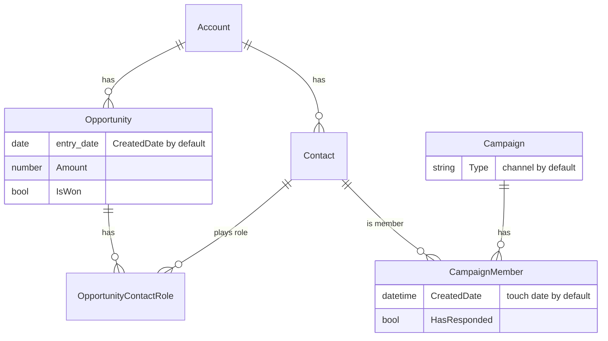

# salesforce-pipeline-attribution

Multi-touch campaign and channel attribution for Salesforce opportunities, plus a self-contained pipeline dashboard. Python standard library only. Read-only against Salesforce.

It answers questions like "how much pipeline did paid ads contribute this year?" with numbers you can trace back to individual campaign member records.

## The problem

Salesforce's built-in campaign influence is hard to defend in a channel review:

- The default model credits 100% of an opportunity to one Primary Campaign Source. If opportunities are created by hand, that field is mostly empty.
- Custom Campaign Influence models exist but are opaque. You can't easily see which touches were counted or why.
- Campaign-level reporting doesn't roll up to channels (paid, events, email, organic), which is the question marketing leadership actually asks.

This tool reads the raw records (campaign members, opportunity contact roles, opportunities), applies a few simple, documented models, and rolls credit up by campaign and by channel. Because the math is a small set of pure functions, you can check any number by hand.

## How it works

For each opportunity:

1. Find its **pipeline-entry date** (default `CreatedDate`, configurable).
2. Collect the **touches**: campaign memberships of the contacts on the opportunity's contact roles (and optionally every contact on the account) dated on or before the entry date and within a lookback window (default 365 days).
3. Sort touches oldest to newest and split the opportunity amount across them with each model's weights.
4. Roll the credited amount up by campaign and by channel. Opportunities with no touches are shown as `(no touches)`, so every model's totals add up to the same number.

### Models

For `n` touches ordered oldest to newest, weight of touch `i` (1-based):

| Model | Formula | Example, 4 touches |
|---|---|---|
| `first_touch` | `w1 = 1`, others 0 | 1, 0, 0, 0 |
| `last_touch` | `wn = 1`, others 0 | 0, 0, 0, 1 |
| `linear` | `wi = 1/n` | 0.25 each |
| `u_shaped` | `w1 = 0.4`, `wn = 0.4`, middle touches share the remaining `0.2` equally | 0.4, 0.1, 0.1, 0.4 |

Edge cases for `u_shaped`: one touch gets 1.0; two touches get 0.5 each (the first/last weights renormalised). The 0.4/0.4 split is configurable.

Credited amount = opportunity amount x weight. Credited opportunities are fractional (a 0.4 weight counts as 0.4 of an opportunity).

### Data model



A touch is a `CampaignMember` row. It belongs to an opportunity when its contact is on the opportunity's contact roles (`touch_scope: contact_roles`), is any contact on the opportunity's account (`account_contacts`), or either (`both`).

## Quick start

Try it without Salesforce, using the fictional data in `sample_data/`:

```
python3 -m pipeattr --offline sample_data
open output/report.html
```

Against your org (Python 3.9+, no installs):

```
cp config.example.json config.json      # edit field names
sf org login web --alias my-org         # or export SF_INSTANCE_URL and SF_ACCESS_TOKEN
python3 -m pipeattr --org my-org --since 2025-01-01
```

Auth: if `SF_INSTANCE_URL` and `SF_ACCESS_TOKEN` are both set they are used. Otherwise the tool runs `sf org display --json --target-org <alias>` and reads the access token from its output. Nothing is written to disk besides `output/`. Don't commit tokens; `.gitignore` already excludes `config.json`, `.env` and `output/`.

Outputs, in `output/`:

- `report.html`: one self-contained page (inline CSS and SVG, no JavaScript, no external requests) with the pipeline dashboard and both attribution tables.
- `attribution_by_channel.csv`, `attribution_by_campaign.csv`: one row per label and model, with open, won, lost and total credited amount.

Tests (no network):

```
python3 -m unittest discover -s tests -t .
```

### Dashboard contents

Pipeline created by month and quarter (keyed on the entry date), breakdown by stage and by source, win rate (by count and by amount, and by close quarter), cycle time for won deals (entry date to close date: average, median, by quarter), and an optional stage funnel from stage date fields. Attribution tables show each model side by side.

### Queries it runs

All read-only SOQL: `Opportunity`, `OpportunityContactRole`, `CampaignMember` (with `Campaign.<channel_field>` and `Contact.AccountId`). With `since` set, the other queries use a semi-join on the same date filter so only relevant rows come back. `account_contacts` scope fetches members through `Contact.AccountId IN (SELECT AccountId FROM Opportunity ...)`.

## Configuration

`config.json` (see `config.example.json`). Everything has a default.

| Key | Default | Meaning |
|---|---|---|
| `entry_date_field` | `CreatedDate` | Opportunity date/datetime field that means "entered pipeline". A custom field such as `Pipeline_Entry_Date__c` is a typical choice. Opportunities where it is empty are excluded and counted in the report header. |
| `source_field` | `LeadSource` | Opportunity field for the "by source" breakdown. |
| `stage_date_fields` | `{}` | Optional `{label: field}` map, e.g. `{"Demo": "Stage_Demo_Date__c"}`. Adds a funnel panel. The `__c` names here are examples, not real fields in your org. |
| `channel_field` | `Type` | Campaign field used as the channel. `Type` is the standard picklist; a custom `Channel__c` is better if you maintain one. |
| `channel_map` | `{}` | Merge or rename raw values, e.g. `{"Webinar": "Events", "Conference": "Events"}`. |
| `touch_scope` | `contact_roles` | `contact_roles`, `account_contacts` or `both`. |
| `touch_date_field` | `CreatedDate` | `CreatedDate` or `FirstRespondedDate` on CampaignMember (falls back to `CreatedDate` if empty). |
| `responded_only` | `false` | Count only members with `HasResponded = true`. |
| `window_days` | `365` | Lookback before entry date. `null` for no limit. |
| `collapse_by_campaign` | `false` | Count each campaign once per opportunity (earliest touch). |
| `u_shaped` | `{first: 0.4, last: 0.4}` | End weights for the U-shaped model. |
| `exclude_campaigns` | `[]` | Campaign names to ignore (test campaigns). |
| `since` | `null` | Only opportunities that entered pipeline on or after this date. Also `--since`. |
| `models` | all four | Which models to report. |

## A note on "stage entered" dates

If you use a custom date field that is stamped when an opportunity enters a stage (and use it as `entry_date_field`), audit it against `OpportunityFieldHistory` by looking at `OldValue`, not only `NewValue`. Opportunities are often created directly into a later stage. That logs no history row for entering the stage; the only evidence is the `OldValue` on the next stage change. Checking `NewValue` alone overcounts the opportunities that are missing the date. Also account for opportunities moved backwards before closing (they did enter the stage), and for field history retention limits on old records.

## Limitations

- **Contact-role coverage.** Only opportunities with contact roles get contact-role touches. If sales rarely adds roles, use `account_contacts` or `both`, and expect that to over-credit (anyone at the account counts). Check the "with campaign touches" percentage in the report before trusting any channel number.
- **Campaign member hygiene.** Results depend on members being added with accurate dates and campaigns having a consistent channel value. Bulk imports that backdate or re-add members, missing `Type`, and duplicate contacts split a person's history across records.
- **Only what Salesforce knows.** Touches that never become a campaign member (ad clicks without a form fill, organic visits, sales outreach) are invisible. Capturing UTMs on every form fill is the real prerequisite for channel attribution; this tool can't create data that isn't there.
- **Rule-based, not causal.** These models distribute credit by position. They don't tell you what would have happened without a campaign.
- **One entry date per opportunity.** Re-opened or multi-product opportunities are treated as a single pipeline entry.
- **Memory-bound.** Everything is loaded in memory; fine for tens of thousands of opportunities, untested beyond that.
- Campaigns are keyed by name in the campaign rollup, so two campaigns with the same name are merged.

## Layout

```
pipeattr/attribution.py   weights, windowing, rollup (pure functions)
pipeattr/metrics.py       dashboard metrics (pure functions)
pipeattr/data.py          loading and normalising records
pipeattr/sfdc.py          auth and read-only REST client
pipeattr/report.py        HTML and CSV output
sample_data/              fictional fixtures for --offline
tests/                    unittest suite
```

## License

MIT
